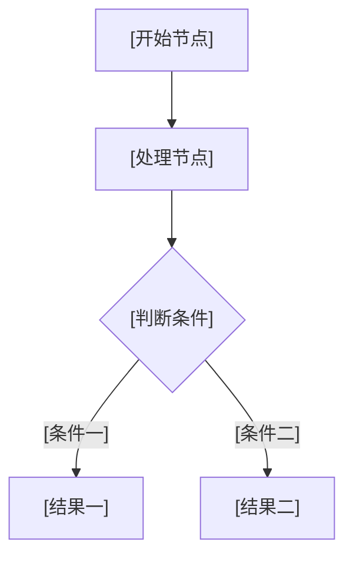

# PRD_[模块或页面名称]

> 使用说明：复制本模板后，将所有 `[填写……]`、`[选择……]` 和示例编号替换为实际内容。模板只定义结构和写法，不代表任何业务规则。
>
> 内容标签：已确认内容标记【事实】；合理判断标记【推断】；优化方案标记【建议】；未确认内容标记【待确认】；仅来自旧系统或历史材料的内容标记【历史资料】。
>
> 反向补档 PRD 例外：正文不使用上述五类标签，也不写标签体系说明；以“页面现状、设计补充、差异说明、来源与依据、待确认问题”等章节或表格列区分内容性质，未决事项只在第 19 章集中登记并用稳定编号引用。
>
> 必须遵循：不得编造规则；已确认删除的功能不得恢复；任何 PRD 必须保留“不做范围”和“待确认问题”。

## 0. 文档信息

> 本章节应该写什么：记录文档的基本身份、当前状态和责任人，便于检索、评审及版本追踪。

| 项目 | 内容 |
| --- | --- |
| 文档名称 | PRD_[模块或页面名称] |
| 所属项目 | 某政务项目服务平台 |
| 当前版本 | [填写版本号，如 V0.1] |
| 文档状态 | [草稿 / 评审中 / 已确认 / 已废止] |
| 编写人 | [填写姓名] |
| 评审人 | [填写姓名或角色] |
| 确认人 | [填写姓名或角色] |
| 创建日期 | [YYYY-MM-DD] |
| 最近更新日期 | [YYYY-MM-DD] |

## 1. 文档说明

> 本章节应该写什么：说明为什么编写本文档、文档覆盖什么内容、依据哪些材料，以及读者如何理解文中的事实等级。不得在此展开具体功能规则。

### 1.1 编写目的

[填写本文档要解决的产品设计、开发实现或测试验收问题。]

### 1.2 需求来源

| 来源编号 | 来源类型 | 材料名称/路径 | 日期 | 确认状态 | 说明 |
| --- | --- | --- | --- | --- | --- |
| 来源-001 | [会议纪要 / 正式文件 / 原型 / 历史资料等] | [填写路径] | [YYYY-MM-DD] | [已确认 / 待确认] | [填写] |

### 1.3 术语与缩写

| 术语/缩写 | 定义 | 适用范围 | 备注 |
| --- | --- | --- | --- |
| [填写] | [引用术语表或给出定义] | [填写] | [填写] |

### 1.4 关联材料

| 类型 | 文件/地址 | 用途 |
| --- | --- | --- |
| 原型 | [填写路径] | [说明对应页面] |
| 流程图 | [填写路径] | [说明对应流程] |
| 字段字典 | `02_结构化台账/字段字典.csv` | 字段统一维护 |
| 权限矩阵 | `02_结构化台账/权限矩阵.csv` | 权限统一维护 |
| 状态流转表 | `02_结构化台账/状态流转表.csv` | 状态统一维护 |
| 测试材料 | [填写路径] | [说明用途] |

## 2. 修订记录

> 本章节应该写什么：集中记录文档每次修订的版本、范围和来源。只维护文档级修订记录，不在各功能点中重复维护版本表。

| 版本 | 日期 | 修改人 | 变更类型 | 变更内容与影响范围 | 变更来源 | 评审/确认人 |
| --- | --- | --- | --- | --- | --- | --- |
| V0.1 | [YYYY-MM-DD] | [填写] | 新增 | 初稿 | [来源-编号] | [填写] |

版本号建议：

- `V0.x`：草稿或评审中；
- `V1.0`：首个确认基线；
- `V1.x`：局部增补或规则澄清；
- `V2.0`：范围、流程或核心模型发生重大变化。

## 3. 业务背景与产品定义

> 本章节应该写什么：说明当前问题、目标用户、建设原因、产品类型、核心对象、能力边界和预期价值。只写与本 PRD 范围直接相关的背景，不写泛化口号，不在此提前展开页面字段和处理规则。

### 3.1 现状与问题

[填写现状、问题表现及影响；正式 PRD 中的历史系统现状必须标记【历史资料】，反向补档 PRD 在来源表说明材料性质即可。]

### 3.2 建设目标

[填写本模块希望达成的可验证目标。]

### 3.3 业务价值

[填写对用户、业务管理或平台协同的价值。]

### 3.4 产品定义

> 本小节应该写什么：从产品视角定义模块是什么、服务谁、管理什么对象、解决什么任务以及不承担什么能力。页面级 PRD 可使用精简表格，平台通用能力类 PRD 应补充生命周期、版本、发布和依赖关系。

| 定义维度 | 内容 |
| --- | --- |
| 产品类型 | [后台管理 / 业务办理 / 平台支撑 / 配置中心 / 其他] |
| 核心对象 | [填写本模块管理或处理的主要对象] |
| 核心用户 | [填写标准角色] |
| 核心任务 | [填写用户在本模块完成的主要任务] |
| 页面形态 | [列表页、详情页、表单、弹窗、二级页面等] |
| 能力边界 | [填写本模块负责和不负责的内容] |

### 3.5 能力架构与功能清单

> 本小节应该写什么：先按能力层级列出完整功能清单，再在第 9 章按同一功能编号逐项展开。清单与明细必须一一对应，不得出现只有清单没有规则或只有明细没有清单的功能。

| 一级能力 | 二级能力 | 功能编号 | 功能名称 | 优先级 | 需求来源 |
| --- | --- | --- | --- | --- | --- |
| [填写] | [填写] | 功能-001 | [对象 + 动作] | [高 / 中 / 低] | 来源-001 |

## 4. 适用范围

> 本章节应该写什么：明确本文档覆盖的端口、角色、业务阶段、页面和数据范围，防止研发或测试扩大解释。

| 范围维度 | 本文档覆盖内容 |
| --- | --- |
| 所属端口 | [个人申报端 / 单位经办端 / 政务管理端 / 专家评审端 / 其他] |
| 用户范围 | [填写标准角色] |
| 功能范围 | [填写模块或功能单元] |
| 页面范围 | [填写页面、弹窗、抽屉] |
| 流程范围 | [填写起点和终点] |
| 数据范围 | [填写数据对象及可见边界] |

## 5. 不做范围

> 本章节应该写什么：明确本期不实现、暂缓、已废弃或由其他系统承接的内容，并给出原因和后续处理。没有明确不做项时也应写“暂无已确认不做项”，不可删除本章。

| 编号 | 不做事项 | 原因 | 承接方/后续处理 | 确认状态 | 来源 |
| --- | --- | --- | --- | --- | --- |
| 不做-001 | [填写] | [填写] | [填写] | [已确认 / 待确认] | [来源-编号] |

旧系统功能应标明：

- 继续办理；
- 停用但保留查询；
- 完全废弃；
- 待确认。

## 6. 用户角色

> 本章节应该写什么：列出参与本模块的标准角色、职责和数据范围。角色名称优先引用 `00_项目口径库/角色权限口径.md`，不得在单份 PRD 中随意创造同义角色。

| 角色 | 所属端口 | 角色职责 | 数据范围 | 参与环节 | 备注 |
| --- | --- | --- | --- | --- | --- |
| [填写标准角色] | [填写] | [填写职责，不展开按钮权限] | [本人 / 本单位 / 授权范围等] | [填写] | [填写] |

## 7. 页面清单

> 本章节应该写什么：列出本 PRD 涉及的所有页面、弹窗和抽屉，并说明其层级、入口、主要任务和关联原型。独立任务或长表单应设计为二级页面；短流程使用弹窗；辅助查看或选择使用抽屉。

| 页面编号 | 页面名称 | 页面类型 | 所属端口 | 主要角色 | 进入方式 | 主要任务 | 关联原型 |
| --- | --- | --- | --- | --- | --- | --- | --- |
| 页面-001 | [填写] | [列表页 / 详情页 / 表单页 / 弹窗 / 抽屉等] | [填写] | [填写] | [菜单 / 按钮 / 待办 / 跳转] | [填写] | [填写路径] |

### 7.1 页面结构说明

> 本小节应该写什么：按页面逐一说明标题区、筛选区、主内容区、操作区和状态区。不要仅引用截图。

**页面一：[页面名称]（页面-001）**

| 页面区域 | 承载内容 | 交互与规则 | 页面状态 |
| --- | --- | --- | --- |
| 标题区 | [填写] | [填写] | [填写] |
| 筛选区 | [填写] | [填写] | [填写] |
| 主内容区 | [填写] | [填写] | [填写] |
| 操作区 | [填写] | [填写] | [填写] |
| 状态区 | [填写] | [填写] | [加载 / 空 / 错 / 无权限等] |

## 8. 业务流程

> 本章节应该写什么：描述业务从触发到结束的完整路径，包括参与角色、用户动作、系统响应、状态变化、分支和异常。Mermaid 流程图用于辅助理解，不能替代步骤表。

### 8.1 流程概述

| 项目 | 内容 |
| --- | --- |
| 流程名称 | [填写] |
| 流程目标 | [填写] |
| 参与角色 | [填写] |
| 触发条件 | [填写] |
| 前置条件 | [填写] |
| 起始状态 | [填写状态编号] |
| 结束条件 | [填写] |
| 结束状态 | [填写状态编号] |

### 8.2 主流程

| 步骤 | 操作角色 | 用户动作 | 系统响应 | 状态变化 | 关联页面/功能 |
| --- | --- | --- | --- | --- | --- |
| 1 | [填写] | [使用动宾结构] | [说明展示、校验、保存或流转] | [原状态 → 新状态] | [页面/功能 编号] |

### 8.3 分支流程

| 分支编号 | 从主流程步骤进入 | 触发条件 | 分支步骤 | 回归点/结束结果 |
| --- | --- | --- | --- | --- |
| 分支-001 | [步骤号] | [填写] | [填写] | [填写] |

### 8.4 流程图

## 9. 核心功能说明

> 本章节应该写什么：按照第 3.5 节功能清单，按可操作、可反馈、可验收的最小功能单元逐项展开。每个功能点必须包含需求来源、功能说明、前置条件、输入、处理规则、输出、异常场景、权限控制和验收标准；不得只写按钮名称或以截图代替规则。

### 9.1 功能一：[功能点名称]

**功能编号**：功能-001

**需求来源**

> 应写什么：引用真实存在的来源编号，说明该功能依据哪个项目口径、会议纪要、正式文件或当前原型。不得引用历史 PRD 作为业务规则来源。

来源-001。

**功能说明**

> 应写什么：说明该功能解决什么问题、由谁使用、从哪里进入以及完成后的业务结果。功能名称使用“对象 + 动作”。

[填写功能说明]

**前置条件**

> 应写什么：列出执行前必须满足的角色、权限、状态、数据完整性、时间窗口或上游结果。

- [前置条件一]
- [前置条件二]

**输入**

> 应写什么：列出用户输入、系统带入、接口返回、选中记录或上传附件等输入。详细规则引用字段编号。

| 输入编号 | 输入内容 | 来源 | 是否必需 | 关联字段 |
| --- | --- | --- | --- | --- |
| 输入-001 | [填写] | [用户录入 / 系统带入 / 接口等] | [是 / 否 / 条件必需] | 字段-001 |

**处理规则**

> 应写什么：按执行顺序写清校验、计算、联动、保存、状态变化和后续动作。每条规则单独编号。正式 PRD 区分事实、推断、建议和待确认；反向补档 PRD 按章节和表格结构区分，不使用方括号标签。

| 规则编号 | 触发条件 | 处理规则 | 关联状态/接口 |
| --- | --- | --- | --- |
| 规则-001 | [填写] | [填写系统处理逻辑] | 业务状态-001 / 接口-001 |

**输出**

> 应写什么：说明成功后的页面反馈、数据结果、状态变化、待办、消息或跳转。

| 输出编号 | 输出内容 | 展示/存储位置 | 下一步 |
| --- | --- | --- | --- |
| 输出-001 | [填写] | [填写] | [填写] |

**异常场景**

> 应写什么：列出本功能特有的失败、边界或冲突场景，并引用异常编号。

| 异常编号 | 触发条件 | 用户提示 | 系统处理 | 恢复方式 |
| --- | --- | --- | --- | --- |
| 异常-001 | [填写] | [填写可执行提示语] | [填写] | [重试 / 返回 / 联系管理员等] |

**权限控制**

> 应写什么：说明谁能看到、谁能操作、可操作哪些数据以及字段是否可见或可编辑，并引用权限编号。

| 权限编号 | 角色 | 页面/按钮权限 | 数据范围 | 字段权限 | 无权限表现 |
| --- | --- | --- | --- | --- | --- |
| 权限-001 | [填写] | [填写] | [填写] | [填写] | [隐藏 / 置灰 / 只读 / 提示] |

**验收标准**

> 应写什么：使用“前置条件—操作—预期结果”描述正常、边界、异常和无权限验收条件，并引用验收编号。

| 编号 | 前置条件 | 操作 | 预期结果 |
| --- | --- | --- | --- |
| 验收-001 | [填写] | [填写] | [填写可观察结果] |

> 复制 `9.1` 全部结构，为后续功能新增“功能二”“功能三”等章节，并使用连续的中文稳定编号。

## 10. 字段说明

> 本章节应该写什么：集中说明查询字段、表单字段和列表字段。一个字段一行，不把多个字段和规则压缩在同一句中；完整技术字段定义同步维护到字段字典。

### 10.1 表单与查询字段

| 字段编号 | 所属页面 | 字段名称 | 控件类型 | 是否必填 | 默认值/回显 | 数据来源 | 可见/可编辑条件 | 校验规则 | 联动规则 | 脱敏要求 | 错误提示 |
| --- | --- | --- | --- | --- | --- | --- | --- | --- | --- | --- | --- |
| 字段-001 | [页面-编号] | [填写] | [输入框 / 下拉框 / 日期等] | [是 / 否 / 条件必填] | [填写] | [填写] | [填写] | [校验-编号] | [填写] | [填写] | [填写] |

### 10.2 列表字段

| 字段编号 | 所属页面 | 列名 | 数据来源 | 展示格式 | 排序/筛选 | 权限与脱敏 | 空值处理 |
| --- | --- | --- | --- | --- | --- | --- | --- |
| 列表字段-001 | [页面-编号] | [填写] | [填写] | [填写] | [填写] | [填写] | [填写] |

### 10.3 按钮与操作

| 操作编号 | 所属页面 | 操作名称 | 出现条件 | 可用条件 | 前置校验 | 成功结果 | 失败处理 |
| --- | --- | --- | --- | --- | --- | --- | --- |
| 操作-001 | [页面-编号] | [填写] | [填写] | [填写] | [校验-编号] | [填写] | [异常-编号] |

## 11. 状态流转

> 本章节应该写什么：集中定义业务状态及合法流转，不在不同页面中重复创造同义状态。页面加载、空数据、编辑中等 UI 状态单独说明。

### 11.1 业务状态定义

| 状态编号 | 状态名称 | 状态含义 | 进入条件 | 可执行操作 | 退出条件 | 是否终态 |
| --- | --- | --- | --- | --- | --- | --- |
| 状态-001 | [填写] | [填写] | [填写] | [操作-编号] | [填写] | [是 / 否] |

### 11.2 状态流转表

| 当前状态 | 触发操作 | 操作角色 | 下一状态 | 系统处理 | 不允许操作 |
| --- | --- | --- | --- | --- | --- |
| [状态-编号] | [操作-编号] | [填写] | [状态-编号] | [填写] | [填写] |

### 11.3 页面状态

| 页面类型 | 状态 | 页面表现 | 按钮表现 | 恢复方式 |
| --- | --- | --- | --- | --- |
| 列表页 | [加载中 / 无数据 / 查询无结果 / 接口异常 / 权限不足等] | [填写] | [填写] | [填写] |
| 详情页 | [只读 / 编辑 / 审批中 / 已退回 / 已办结 / 数据不存在等] | [填写] | [填写] | [填写] |
| 表单页 | [草稿 / 校验失败 / 保存中 / 提交中 / 提交失败 / 不可办理等] | [填写] | [填写] | [填写] |

## 12. 权限控制

> 本章节应该写什么：统一描述菜单/页面、按钮/操作、数据范围和字段四层权限。角色权限必须与项目权限口径及权限矩阵一致，前端隐藏不能替代服务端鉴权。

| 权限编号 | 角色 | 页面/功能 | 页面权限 | 操作权限 | 数据范围 | 字段权限 | 无权限表现 |
| --- | --- | --- | --- | --- | --- | --- | --- |
| 权限-001 | [标准角色] | [页面/功能 编号] | [可见 / 不可见] | [操作-编号] | [填写] | [可见 / 脱敏 / 可编辑 / 只读] | [填写] |

## 13. 校验规则

> 本章节应该写什么：集中描述必填、格式、长度、范围、唯一性、跨字段、跨记录和状态校验。写清触发时机、失败提示和阻断范围。

| 校验编号 | 适用页面/功能 | 校验对象 | 触发时机 | 校验条件 | 失败提示 | 是否阻断 | 处理方式 |
| --- | --- | --- | --- | --- | --- | --- | --- |
| 校验-001 | [页面/功能 编号] | [字段/操作 编号] | [输入时 / 保存时 / 提交时等] | [填写] | [填写明确提示语] | [是 / 否] | [定位字段 / 保留数据 / 重试等] |

## 14. 异常场景

> 本章节应该写什么：集中描述校验失败、数据变化、重复提交、接口失败、权限不足、附件失败、状态失效和数据缺失等异常。异常提示应说明发生了什么以及用户下一步可以做什么。

| 异常编号 | 场景 | 触发条件 | 系统处理 | 用户提示 | 数据处理 | 恢复方式 | 日志/通知 |
| --- | --- | --- | --- | --- | --- | --- | --- |
| 异常-001 | [填写] | [填写] | [填写] | [填写] | [保留 / 回滚 / 不落库等] | [填写] | [日志/消息 编号] |

至少按适用范围检查：

- 必填、格式、范围和跨字段校验失败；
- 数据不存在、已删除或被其他用户修改；
- 重复点击、重复提交和幂等；
- 接口失败、超时和部分成功；
- 权限不足或数据越权；
- 附件上传、下载和预览失败；
- 状态已变化导致操作失效；
- 字典、组织或关联数据缺失；
- 事项停用、记录过期或不可办理。

## 15. 接口、数据与非功能要求

> 本章节应该写什么：说明外部或内部接口依赖、数据来源、字典、附件、同步方式、敏感信息、一致性和可验证的非功能要求。未确认的接口字段及性能数值不得自行编造。

### 15.1 接口清单

| 接口编号 | 接口名称 | 调用方/提供方 | 触发时机 | 请求摘要 | 返回摘要 | 超时/重试 | 失败降级 | 确认状态 |
| --- | --- | --- | --- | --- | --- | --- | --- | --- |
| 接口-001 | [填写] | [填写] | [填写] | [引用接口文档] | [引用接口文档] | [填写] | [填写] | [已确认 / 待确认] |

### 15.2 数据要求

| 数据编号 | 数据对象 | 数据来源 | 维护方 | 更新方式 | 唯一标识 | 保存期限 | 敏感级别 | 一致性要求 |
| --- | --- | --- | --- | --- | --- | --- | --- | --- |
| 数据-001 | [填写] | [填写] | [填写] | [实时 / 定时 / 人工等] | [填写] | [填写] | [填写] | [填写] |

### 15.3 字典与枚举

| 字典编号 | 字典名称 | 使用字段 | 来源 | 维护方 | 版本/快照要求 |
| --- | --- | --- | --- | --- | --- |
| 字典-001 | [填写] | [字段-编号] | [填写] | [填写] | [填写] |

### 15.4 非功能要求

| 维度 | 要求 | 验证方式 | 确认状态 |
| --- | --- | --- | --- |
| 安全 | [填写鉴权、脱敏、防越权等要求] | [填写验证方式] | [已确认 / 待确认] |
| 性能 | [填写已确认的响应、并发或容量指标；无来源时标记待确认] | [填写验证方式] | [已确认 / 待确认] |
| 可用性 | [填写加载、空、错、恢复及幂等要求] | [填写验证方式] | [已确认 / 待确认] |
| 兼容性 | [填写已确认的浏览器、终端或分辨率范围] | [填写验证方式] | [已确认 / 待确认] |
| 可维护性 | [填写配置化、日志、字典及错误处理要求] | [填写验证方式] | [已确认 / 待确认] |

### 15.5 附件要求

| 材料编号 | 材料名称 | 是否必传 | 格式 | 大小/数量 | 上传时机 | 预览/下载 | 失败处理 |
| --- | --- | --- | --- | --- | --- | --- | --- |
| 附件-001 | [填写] | [是 / 否 / 条件必传] | [填写] | [填写] | [填写] | [填写] | [异常-编号] |

## 16. 日志 / 留痕

> 本章节应该写什么：说明哪些关键操作必须记录，日志包含哪些字段、保存多久、谁能查询，以及是否需要记录变更前后值。涉及审批、提交、退回、删除、权限和配置变更时必须评估留痕。

| 日志编号 | 操作场景 | 触发动作 | 操作人信息 | 业务对象 | 记录内容 | 变更前后值 | 保存期限 | 查询权限 |
| --- | --- | --- | --- | --- | --- | --- | --- | --- |
| 日志-001 | [填写] | [操作-编号] | [用户ID、角色等] | [填写] | [时间、结果、原因等] | [是 / 否] | [填写] | [填写] |

## 17. 消息通知

> 本章节应该写什么：说明通知事件、接收对象、渠道、发送时机、模板变量、失败重试和追踪要求。消息通知入口按项目固定口径位于顶部导航栏右上角。

| 消息编号 | 触发事件 | 接收角色/对象 | 通知渠道 | 发送时机 | 模板/内容要点 | 模板变量 | 失败重试 | 跳转目标 |
| --- | --- | --- | --- | --- | --- | --- | --- | --- |
| 消息-001 | [填写] | [填写] | [站内信 / 短信 / 其他] | [实时 / 定时等] | [填写，不写未确认正式文案] | [填写] | [填写] | [页面-编号] |

如本模块不发送消息，应写明“不适用”及原因，不删除本章。

## 18. 验收标准

> 本章节应该写什么：汇总关键功能的正常、边界、异常和无权限验收场景。每条标准只验证一个主要结果，结果必须可观察、可重复验证。

| 编号 | 关联需求 | 前置条件 | 操作 | 预期结果 | 优先级 |
| --- | --- | --- | --- | --- | --- |
| 验收-001 | [功能/规则/校验/异常 编号] | [角色、权限、状态和数据条件] | [填写操作] | [页面反馈、数据变化和状态变化] | [高 / 中 / 低] |

不得使用“功能正常”“展示正确”“操作友好”等不可验证表达。验收标准应能直接转化为 `07_测试验收` 下的测试点。

## 19. 待确认问题

> 本章节应该写什么：汇总所有待确认事项，说明影响范围、建议责任方和确认状态。正式 PRD 正文中的待确认内容必须引用本表编号；反向补档 PRD 的未决事项只在本表集中登记，正文需要关联时直接写“见待确认-xxx”。

| 编号 | 待确认问题 | 提出依据 | 影响页面/功能 | 影响字段/流程/状态 | 优先级 | 建议确认方 | 期望确认时间 | 当前状态 |
| --- | --- | --- | --- | --- | --- | --- | --- | --- |
| 待确认-001 | [填写问题，不写预设答案] | [来源-编号] | [页面/功能 编号] | [填写] | [高 / 中 / 低] | [填写] | [YYYY-MM-DD] | [待确认 / 已确认 / 已关闭] |

## 20. 发布前检查

> 本章节应该写什么：在 PRD 进入评审、开发或测试前确认文档与项目其他资产一致。逐项勾选，不满足时不得将文档标记为“已确认”。

- [ ] 正式 PRD 已区分【事实】【推断】【建议】【待确认】【历史资料】；反向补档 PRD 已按结构区分内容性质且正文未使用五类标签。
- [ ] 已包含适用范围、不做范围和待确认问题。
- [ ] 页面、字段、按钮、权限、状态和异常描述完整。
- [ ] 每个功能点均包含规定的九项内容。
- [ ] 主流程、分支流程和跨角色交接可以闭环。
- [ ] 关键功能已有可测试的验收标准。
- [ ] 与 HTML 原型、页面清单和字段字典一致。
- [ ] 与权限矩阵、状态流转表和流程图一致。
- [ ] 已确认删除的功能未被重新加入。
- [ ] 所有示例值均明确标记为占位内容。
